**English** | [Русский](README.ru.md)

# PaintCraft

Paint pictures right in the game. Paper 1.20 – 26.3, one jar for every version, no resource pack and no other plugins required.

Place a canvas on a wall, take the brush and paint with your crosshair like with a mouse.
A finished painting can be signed, copied, moved to another wall, or turned into a string and sent to anyone.

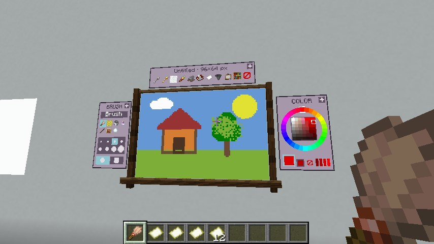

The idea comes from the [MC Paint](https://modrinth.com/datapack/mc-paint) datapack, but here a canvas is made of
regular maps in invisible item frames, so the client has nothing to download.

## Features

- **Paint with the crosshair.** Hold RMB to draw, release to finish the stroke. Strokes show up instantly.
- **Panel next to the canvas**: point the brush at a canvas and buttons slide out — tools, brush sizes and shape on the left,
  a color wheel on the right, painting actions on top. Only the painter sees the panel. Windows can be dragged around.
- **Seven tools**: brush, eraser, fill, spray can, line, rectangle, ellipse. Shift keeps lines straight and turns
  a rectangle into a square and an ellipse into a circle. The brush is round or square.
- **244 colors** — the whole map palette. Pick on the wheel, enter `#RRGGBB`, or take a color from a canvas or **any block**.
- **Canvases from 1×1 to 5×5 blocks**, any proportions (the limit can be raised to 16×16), on walls, floors and ceilings.
  16, 32, 64 or 128 pixels per block, changeable on a finished drawing.
- **Undo and redo** — 30 steps per painting.
- **Transparent color** for stickers and paintings of any shape.
- **Glowing paintings**: use a glow ink sac on a painting.
- **Signing and copies**: a signed painting can't be changed but can be copied in a crafting table, like a book.
- **Export and import as a string.** A 96×64 drawing is about 460 characters.
- **Images from the web** by URL: crop or fit, zoom, offset, brightness, contrast, saturation, dithering.
- **Placement preview**: while you hold a canvas, the spot it will take glows on the wall.
- **Painting together**: the author can open a canvas for everyone.
- **My paintings** — everything you painted stays in storage even if the item is lost.
- **18 languages**, switched with `/paint language`.

## Install

Drop one of the jars into `plugins`:

- `paintcraft-1.0.0.jar` — English by default
- `paintcraft-1.0.0-ru.jar` — Russian by default

The jars are otherwise identical. PacketEvents is bundled inside, you don't need it as a separate plugin.

The same jar runs on Paper 1.20 and newer. Older servers lack some client features, so a few things work differently:

| Server | What is different |
|---|---|
| before 1.21.9 | Panel icons are item displays instead of text sprites |
| before 1.21.6 | No dialog windows: titles, color codes and painting codes are typed in chat, image settings and the canvas size table are chest menus. Codes are copied by clicking a chat message and go in parts of 200 characters |
| 1.21.4 – 1.21.10 | You walk slower while you hold RMB with the brush |
| before 1.21.4 | Plugin items are a regular brush, paper and painting item. A stroke ends a quarter of a second after you release RMB |
| 1.20 – 1.20.1 | Colors can't be picked from blocks, only from canvases |

## Language

```
/paint language        current language and the list
/paint language ru     switch
```

Bundled: en, ru, uk, de, fr, es, pt, it, pl, tr, nl, cs, sv, zh, ja, ko, vi, id.

The choice is saved to `config.yml` (`language: en`). Translations live in `plugins/paintcraft/lang/` and can be edited;
put your own `xx.yml` there and it becomes available as `/paint language xx`. Missing keys fall back to English.
Items that were already given out keep the text they were created with.

## Quick start

1. Craft a **brush** (stick + feather) and a **canvas** (paper + stick).
2. Need a bigger one? Hold a stack of 1×1 canvases and press **Shift + RMB** to pick a size: a 2×4 canvas takes eight.
   A crafting table works too: identical canvases laid out as a rectangle merge into one.

   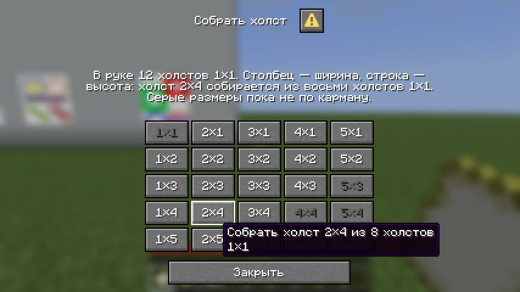
3. Place the canvas with RMB on a wall, floor or ceiling.
4. Take the brush and paint.

### Brush controls

| Action | What it does |
|---|---|
| RMB on a canvas (can be held) | Paint with the current tool |
| LMB on a canvas | Pick the color under the crosshair |
| LMB on a block | Pick the block's map color |
| RMB or LMB on a panel button | Press it |
| Shift + RMB off the canvas | Palette and tools as a chest menu |
| Shift while painting | Straight line, square, circle |
| Shift + mouse wheel | Brush size |
| Q / Shift + Q | Previous / next tool |
| F / Shift + F | Undo / redo |

You can paint from up to 6 blocks away.

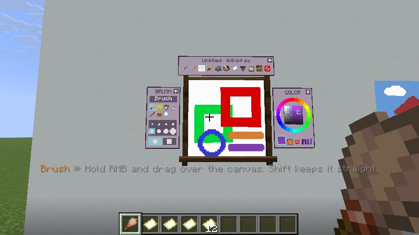

### The panel

| | |
|---|---|
| 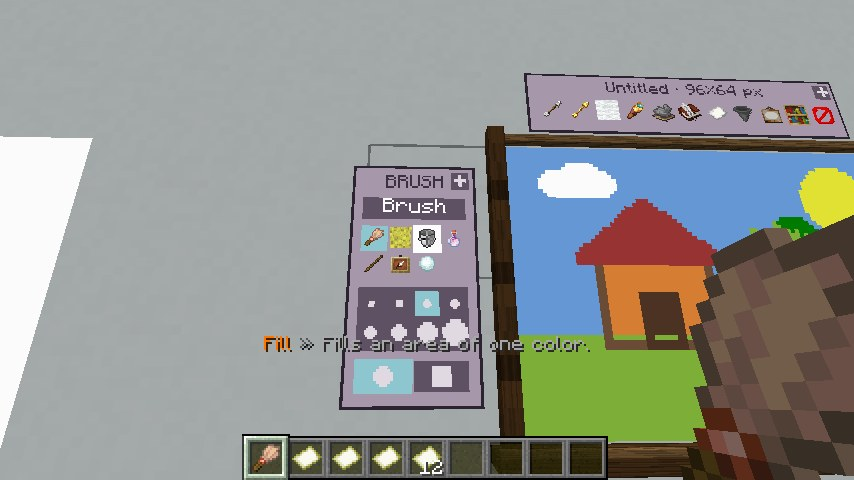 | 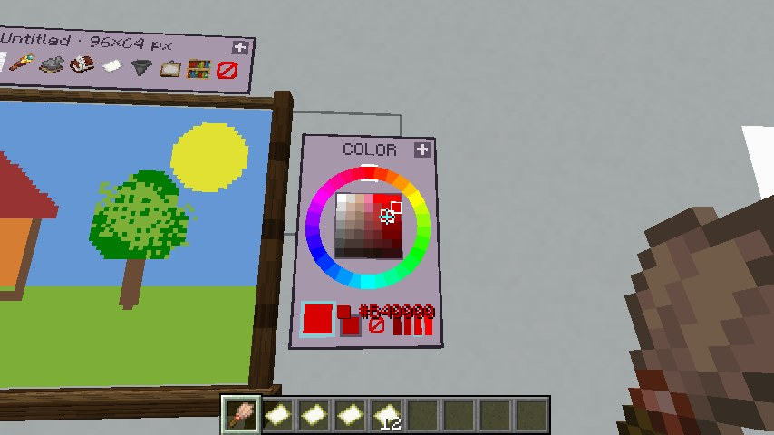 |

Every window has a `+` handle in the top right corner: hold RMB on it and drag, the window follows your crosshair and
flows around the canvas and the other windows. With LMB it's two clicks: grab and drop. Shift + click puts a window back,
`/paint panel` resets all three. The layout is remembered per player and used for every canvas.

| | |
|---|---|
| 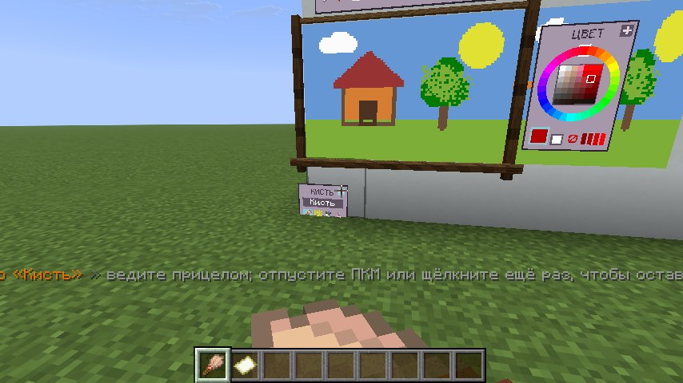 | 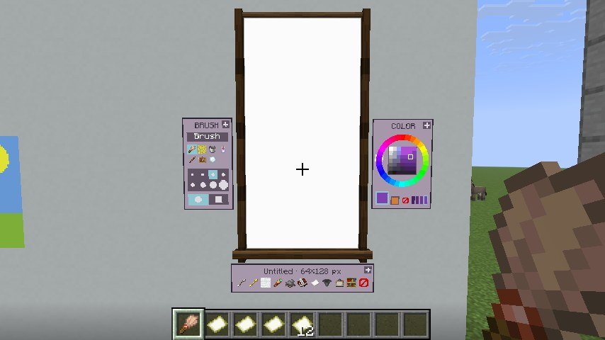 |

### What to do with a painting

| Action | What it does |
|---|---|
| LMB on a painting without the brush | Take it down |
| RMB with a glow ink sac | Make it glow (a regular ink sac reverts it) |
| Painting + blank canvas of the same size in a crafting table | A copy. Signed paintings only |
| A single painting in a crafting table | A blank canvas. The drawing stays in "My paintings" |
| A single big canvas in a crafting table | 1×1 canvases back |

Only the player who placed a painting can take it down. Only the author paints on it, unless "Anyone can paint" is on.

## Screenshots

| | |
|---|---|
| 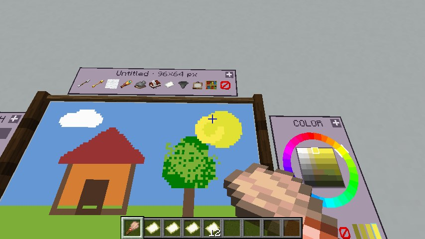 | 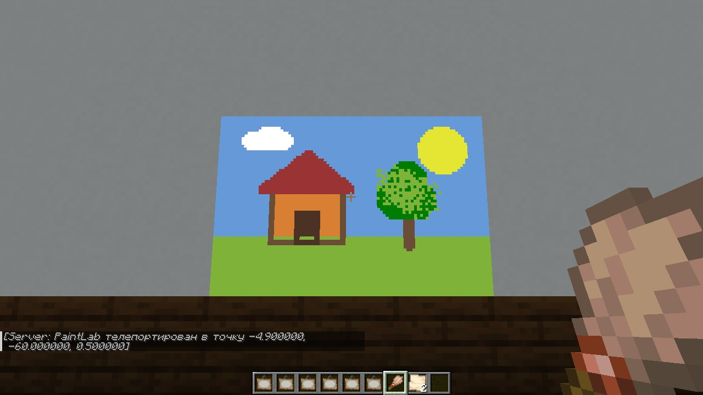 |
| 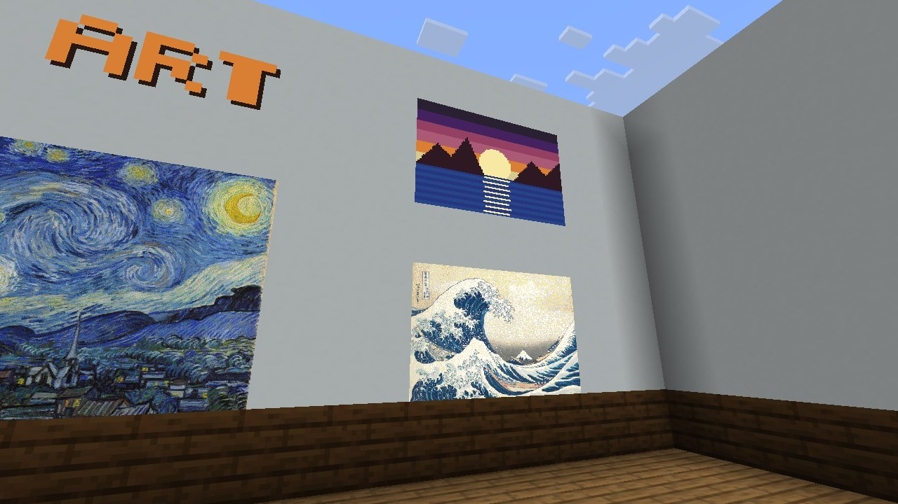 | 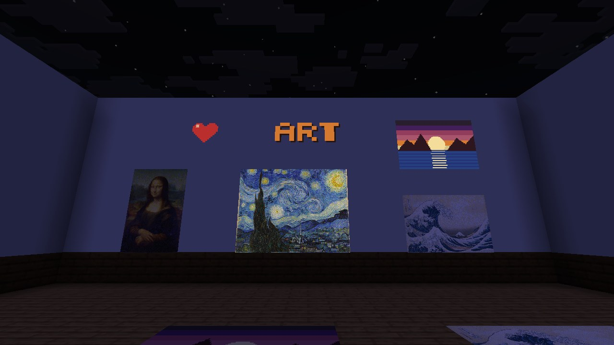 |
| 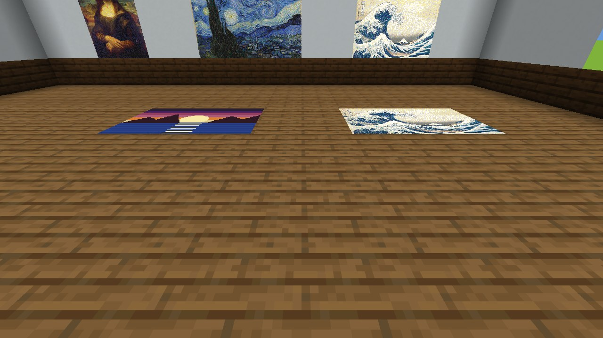 | 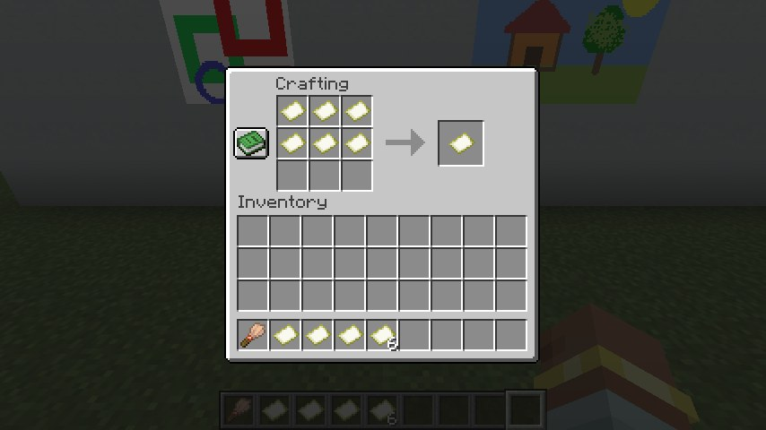 |
| 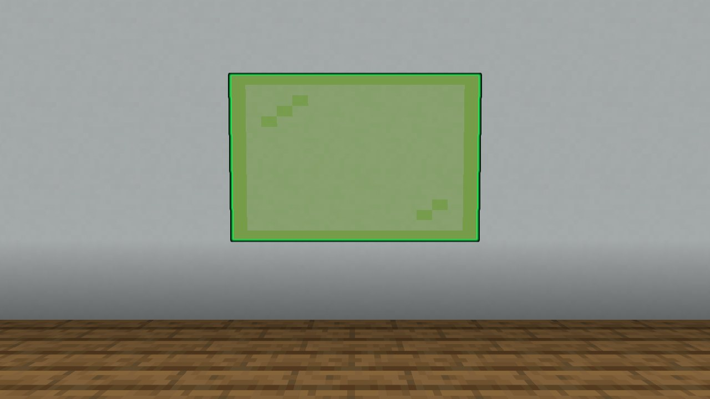 | 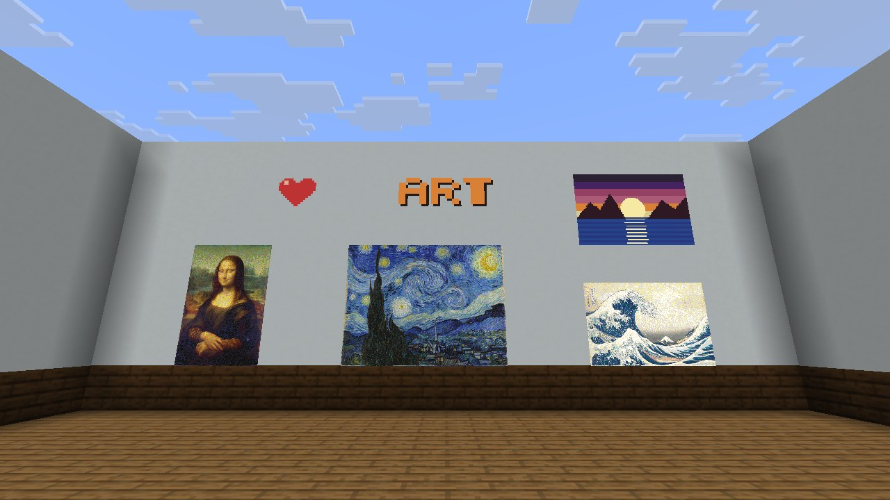 |

The Mona Lisa, The Starry Night and The Great Wave off Kanagawa (public domain) were loaded with `/paint image`.

| | |
|---|---|
| 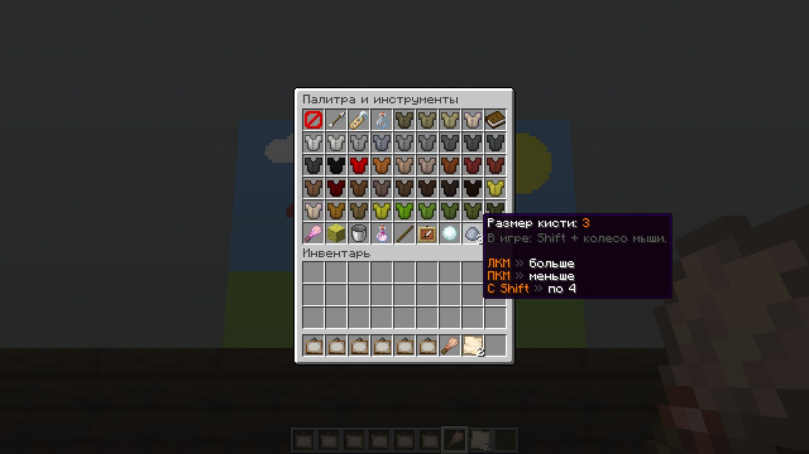 | 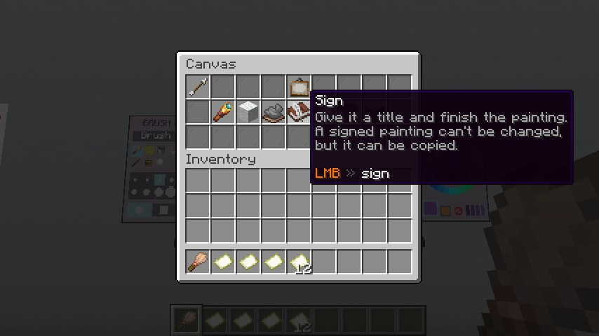 |
| 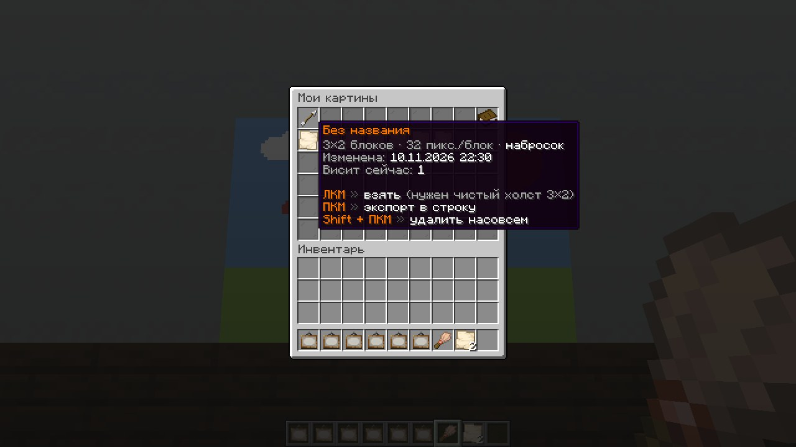 | 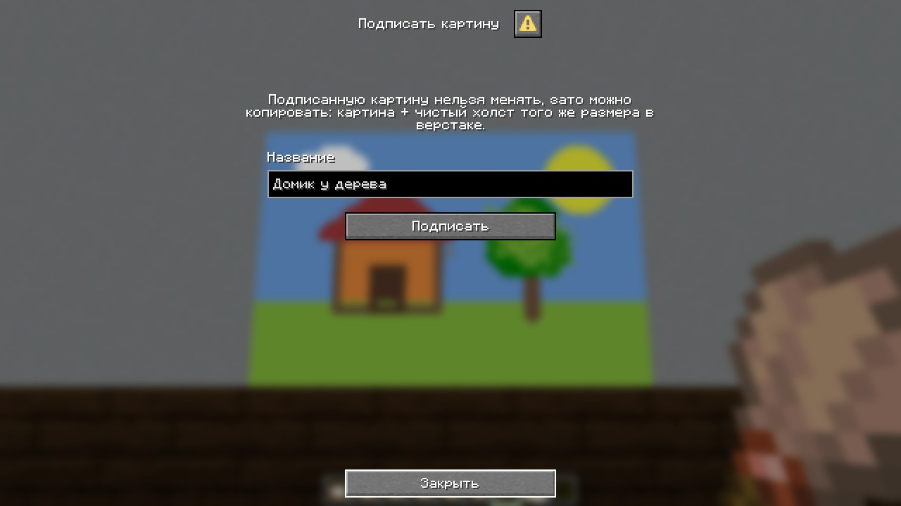 |
| 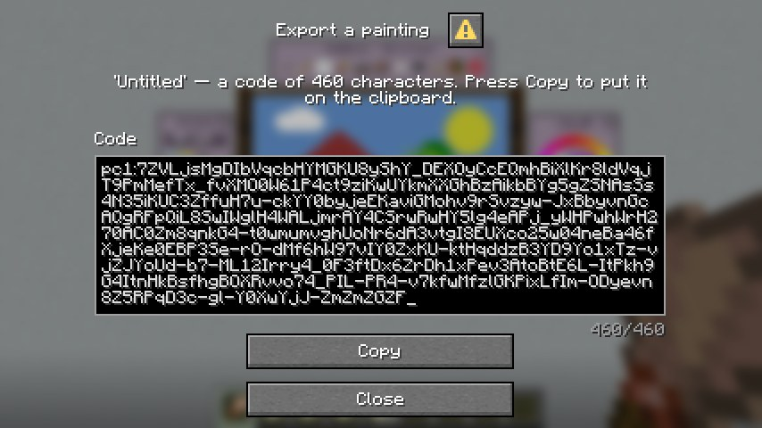 | 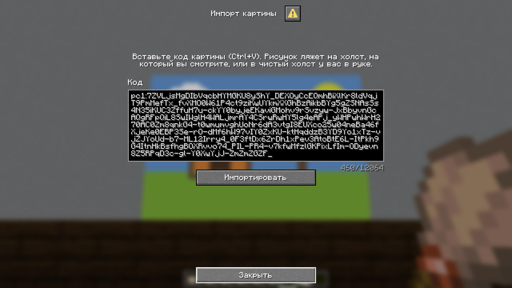 |

## Export and import

`/paint export` shows the painting code with a Copy button. The house drawing from the screenshot above, 96×64 pixels:

```
pc1:7ZVLjsMgDIbVqcbHYMGKU8yShY_DEXOyCcEQmhBiXlKr8ldVqjT9PmMefTx_fvXMO0W61P4ct9ziKwUYkmXXGhBzAikbBYg5gZSNAsSs4N35iKUC3ZffuH7u-ckYY0byjeEKaviGMohv9rSvzyw-JxBbyvnGcAQgRFpQiL8SwIWglH4WALjmrAY4CSrwRwHY5lg4eAPj_yWHPwhWrH270AC0Zm8qnkG4-t0wmumvghUoNr6dA3vtgI8EUXco25w04neBa46fXjeKe0EBP3Se-rO-dMf6hW97vIY0ZxKU-ktHqddzB3YD9Yo1xTz-vjZJYoUd-b7-ML12Irry4_0F3ftDx6ZrDh1xPev3AtoBtE6L-ItPkh9G4ItnHkBsfhgBOXRvvo74_PIL-PR4-v7kfwMfzlGKPixLfIm-ODyevn8Z5RPqD3c-gl-Y0XwYjJ-ZmZmZGZF_
```

`/paint import` opens a window to paste a code. The drawing goes:

- onto the canvas you are looking at, if it's yours (F undoes it);
- otherwise into a blank canvas in your hand;
- in creative mode a new painting is simply created.

A code isn't tied to a server, a world or a game version. If the canvas has another size, the drawing is stretched.

Importing costs paper: one sheet per block of the painting (configurable). Free in creative mode and for admins.

Imported paintings are marked: the item gets a yellow "Import" line, and menus show "import" next to the state.
The mark goes away only when the import is undone or the canvas is cleared.

Very long codes are split into parts of about 12 thousand characters; the windows walk you through them.

### Images from a URL

`/paint image [url]` or the panel button opens a window with settings:

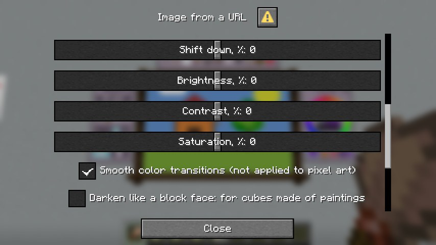

The image goes to the same place a code would. Tuning is easiest on a canvas that already hangs: apply, look,
open the window again — settings are kept, the previous result is replaced and paper isn't charged twice.

`paintcraft.image` is op-only by default because the server itself downloads the URL. Localhost and LAN addresses are
refused unless allowed in the config.

#### A painting as a block

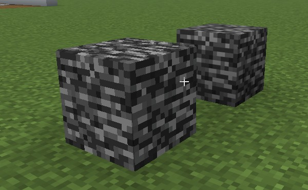

Left: a block covered with three paintings of the bedrock texture. Right: real bedrock.

- import the 16×16 texture onto a 1×1 canvas;
- tick **"Darken like a block face"**: the game shades block faces by direction and doesn't shade maps.
  The correction depends on where the canvas faces, so import onto a canvas that already hangs, each face separately;
- put a block of a similar color underneath: maps in frames are always drawn 1/128 of a block above the surface,
  so a thin seam shows the block below.

## Admin menu

`/paint admin` gives plugin items (Shift + LMB for 64) and lists every painting on the server:
LMB to take, RMB to export, Shift + RMB twice to delete forever.

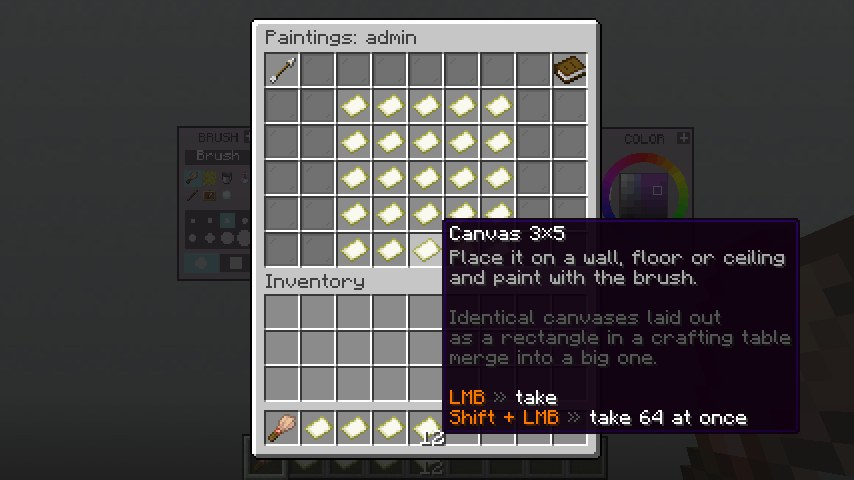

## Commands

`/paint`, also `/paintcraft`. Painting commands apply to the painting you look at, then to the one in your hand.

| Command | What it does |
|---|---|
| `/paint` | Palette and tools |
| `/paint gallery` | My paintings |
| `/paint color <#RRGGBB>` | Color, the nearest one from the map palette |
| `/paint size <number>` | Brush size in canvas pixels |
| `/paint tool <brush\|eraser\|fill\|spray\|line\|rect\|ellipse>` | Tool |
| `/paint undo`, `/paint redo` | Undo and redo |
| `/paint panel` | Put moved panel windows back |
| `/paint clear` | Fill the canvas with white (can be undone) |
| `/paint sign [title]` | Sign |
| `/paint export` | Painting code |
| `/paint import [code]` | Paste a code |
| `/paint image [url]` | Image from the web |
| `/paint admin` | Items and all paintings |
| `/paint give <brush\|canvas> [WxH] [amount] [player]` | Give the brush or canvases |
| `/paint language [code]` | Plugin language |
| `/paint reload` | Reload config.yml and translations |
| `/paint help` | Short help |

### Permissions

| Permission | Default | Gives |
|---|---|---|
| `paintcraft.use` | everyone | Painting, placing canvases, `/paint` and menus |
| `paintcraft.export` | everyone | Export |
| `paintcraft.import` | everyone | Import |
| `paintcraft.image` | op | `/paint image` |
| `paintcraft.give` | op | `/paint give` |
| `paintcraft.admin` | op | Other players' paintings, `/paint reload`, `/paint language`, no limits and no costs. Includes everything above |

## Config

`plugins/paintcraft/config.yml`, applied with `/paint reload`.

| Setting | Default | Meaning |
|---|---|---|
| `language` | en | Plugin language |
| `canvas.max-size` | 5 | Biggest canvas side in blocks, up to 16 |
| `canvas.default-resolution` | 32 | Pixels per block of a new canvas |
| `canvas.resolutions` | 16, 32, 64, 128 | Resolutions players can choose |
| `canvas.reach` | 6.0 | Painting distance |
| `brush.max-size` | 32 | Biggest brush |
| `brush.eraser-transparent` | false | The eraser makes pixels transparent instead of white |
| `limits.paintings-per-player` | 200 | 0 — unlimited |
| `limits.undo-steps` | 30 | Undo steps per painting |
| `protection.only-placer-breaks` | true | Only the placer can take a painting down |
| `import.paper-per-block` | 1 | Paper per block of the painting, 0 — free |
| `import.code` | true | Import from a string |
| `import.image-url` | true | Import images from a URL |
| `import.image-max-bytes` | 8 MB | Download size limit |
| `import.image-resolution` | 128 | Resolution of paintings created from an image |
| `import.image-allow-private-hosts` | false | Allow localhost and LAN URLs |
| `autosave-seconds` | 20 | How often changed paintings are saved |
| `recipes.brush`, `recipes.canvas` | stick + feather, paper + stick | Shapeless recipe ingredients |

Placing and breaking go through the regular `HangingPlaceEvent` and `HangingBreakByEntityEvent`, so protection plugins work.

## Notes

- Colors are limited to what a map can show: 61 base colors with 4 shades each.
- Drawings are stored by the plugin in `plugins/paintcraft/paintings`. Without the plugin the maps in frames are empty.
- A sketch taken from "My paintings" twice is the same painting: edits show up wherever it hangs.
- When the author deletes a painting it disappears from walls and its items turn into blank canvases.

## Build

JDK 21 or newer.

```bash
./gradlew build
```

Both jars end up in `build/libs`.
