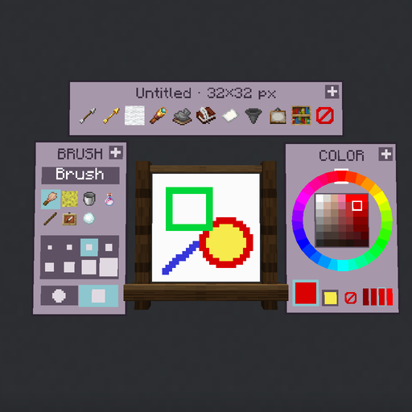
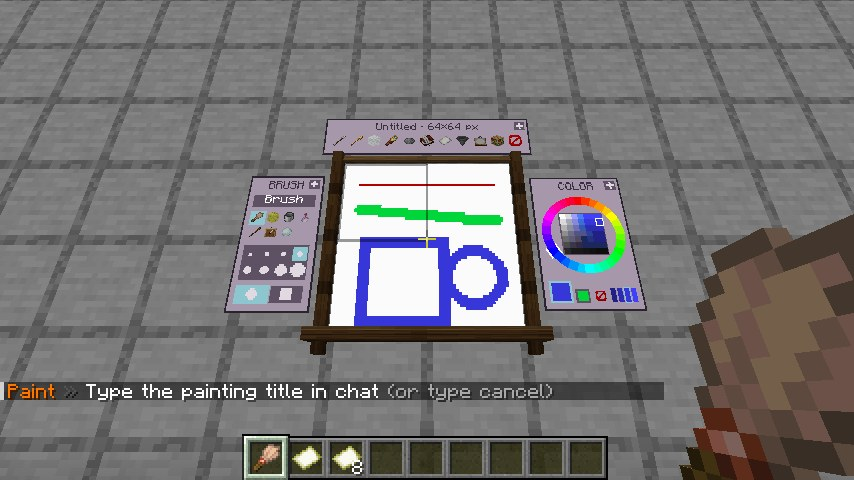
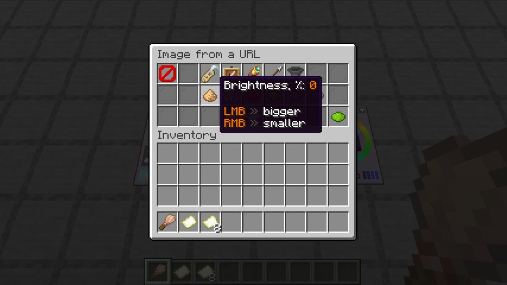
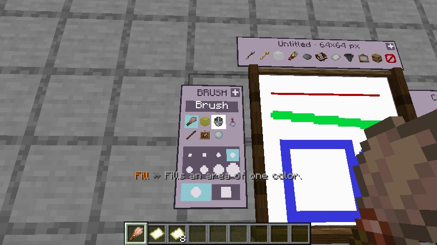

<p align="center">
  
</p>

<h1 align="center">MapPaint</h1>

<p align="center">
  Рисование картин прямо в игре: без ресурспака и без других плагинов.<br>
  Плагин для <b>Paper 1.20 – 26.3</b>, один jar на все версии. 18 языков.
</p>

<p align="center">
  <a href="https://modrinth.com/plugin/mappaint"></a>
  <a href="https://www.curseforge.com/minecraft/bukkit-plugins/mappaint"></a>
  <a href="https://github.com/BbIJABNPOBATEJb/MapPaint/releases"></a>
</p>

<p align="center">
  <a href="README.md">English</a> | <b>Русский</b>
</p>

Ставите холст на стену, берёте кисть и рисуете прицелом, как мышью.
Готовую картину можно подписать, скопировать, перевесить или превратить в строку и передать кому угодно.


Идея взята у датапака [MC Paint](https://modrinth.com/datapack/mc-paint), но здесь холст — обычные карты
в невидимых рамках, поэтому клиенту ничего не нужно скачивать.

## Что умеет

- **Рисование прицелом.** Зажали ПКМ — ведёте линию, отпустили — мазок закончен. Мазок виден сразу.
- **Панель у холста**: навели кисть на холст — выезжают кнопки: слева инструменты, размеры и форма кисти,
  справа цветовой круг, сверху действия с картиной. Панель видит только тот, кто рисует. Окна можно двигать.
- **Семь инструментов**: кисть, ластик, заливка, баллончик, линия, прямоугольник, эллипс. С Shift линия идёт ровно,
  прямоугольник становится квадратом, эллипс — кругом. Кисть круглая или квадратная.
- **244 цвета** — вся палитра карт. Цвет выбирается на круге, вводится как `#RRGGBB` или берётся с холста и **с любого блока**.
- **Холсты от 1×1 до 5×5 блоков**, любых пропорций (предел поднимается до 16×16), на стене, полу и потолке.
  16, 32, 64 или 128 пикселей на блок, меняется и на готовом рисунке.
- **Отмена и возврат** — 30 шагов на картину.
- **Прозрачный цвет** для наклеек и картин любой формы.
- **Светящиеся картины**: щёлкните по картине мешочком светящихся чернил.
- **Подпись и копии**: подписанную картину нельзя менять, зато можно размножить в верстаке, как книгу.
- **Экспорт и импорт в строку.** Рисунок 96×64 — это около 460 символов.
- **Картинки из интернета** по ссылке: обрезать или вписать, увеличить, сдвинуть, яркость, контраст, насыщенность.
- **Проекция места установки**: пока холст в руке, на стене светится место, которое он займёт.
- **Совместное рисование**: автор может открыть холст для всех.
- **«Мои картины»** — всё нарисованное остаётся в хранилище, даже если предмет потерян.
- **18 языков**, переключаются командой `/paint language`.

## Установка

Положите в `plugins` одну из jar:

- `mappaint-1.0.0.jar` — по умолчанию английский
- `mappaint-1.0.0-ru.jar` — по умолчанию русский

В остальном они одинаковые. PacketEvents уже внутри, отдельным плагином он не нужен.

## Версии

Одна jar для Paper **1.20 – 26.3**. Рисование, панель, меню, экспорт, импорт и картинки работают на любой версии.
От версии зависит:

| | 1.20 – 1.20.1 | 1.20.2 – 1.21.3 | 1.21.4 – 1.21.5 | 1.21.6 – 1.21.8 | 1.21.9 – 1.21.10 | 1.21.11 – 26.3 |
|---|:-:|:-:|:-:|:-:|:-:|:-:|
| Окна ввода | чат и меню-сундуки | чат и меню-сундуки | чат и меню-сундуки | ✔ диалоги | ✔ диалоги | ✔ диалоги |
| Значки панели | предметные дисплеи | предметные дисплеи | предметные дисплеи | предметные дисплеи | ✔ спрайты | ✔ спрайты |
| Предметы плагина | кисть, бумага, картина | кисть, бумага, картина | ✔ свой вид | ✔ | ✔ | ✔ |
| Конец мазка | через ¼ с после отпускания | через ¼ с после отпускания | ✔ сразу | ✔ | ✔ | ✔ |
| Ходьба во время мазка | ✔ | ✔ | медленнее | медленнее | медленнее | ✔ |
| Цвет с блока | ✘ | ✔ | ✔ | ✔ | ✔ | ✔ |

| 1.21.6 и новее | Старше |
|---|---|
|  Название, код цвета и код картины вводятся в окне |  То же пишется в чат; код копируется щелчком по сообщению и идёт частями по 200 символов |
|  Настройки картинки |  Настройки картинки меню-сундуком |

| 1.21.9 и новее | Старше |
|---|---|
|  Значки — спрайты в тексте, всегда яркие |  Значки — предметные дисплеи, на стенах, смотрящих на запад и восток, темнее |

На 1.21.4 и старше под прицелом между плитками холста может быть видна рамка выделения блока.

## Язык

```
/paint language        текущий язык и список
/paint language ru     переключить
```

В комплекте: en, ru, uk, de, fr, es, pt, it, pl, tr, nl, cs, sv, zh, ja, ko, vi, id.

Выбор записывается в `config.yml` (`language: ru`). Переводы лежат в `plugins/mappaint/lang/`, их можно править;
свой файл `xx.yml` в этой папке становится доступен как `/paint language xx`. Чего нет в файле, берётся из английского.
У уже выданных предметов остаётся тот текст, с которым они созданы.

## Быстрый старт

1. Сделайте **кисть** (палка + перо) и **холст** (бумага + палка).
2. Нужен холст побольше — возьмите стопку холстов 1×1 в руку и нажмите **Shift + ПКМ**: холст 2×4 собирается из восьми.
   То же делает верстак: одинаковые холсты, выложенные прямоугольником, склеиваются.

   
3. Поставьте холст ПКМ на стену, пол или потолок.
4. Возьмите кисть и рисуйте.

### Управление кистью

| Действие | Что делает |
|---|---|
| ПКМ по холсту (можно зажать) | Рисовать выбранным инструментом |
| ЛКМ по холсту | Взять цвет под прицелом |
| ЛКМ по блоку | Взять цвет блока, каким он выглядит на карте |
| ПКМ или ЛКМ по кнопке панели | Нажать её |
| Shift + ПКМ мимо холста | Палитра и инструменты окном |
| Shift при рисовании | Ровная линия, квадрат, круг |
| Shift + колесо мыши | Размер кисти |
| Q / Shift + Q | Предыдущий / следующий инструмент |
| F / Shift + F | Отменить / вернуть |

Рисовать можно с расстояния до 6 блоков.


### Панель

| | |
|---|---|
|  |  |

У каждого окна в правом верхнем углу ручка `+`: зажмите на ней ПКМ и ведите — окно идёт за прицелом, обтекая холст
и другие окна. Левой кнопкой — два щелчка: взять и отпустить. Shift + щелчок возвращает окно на место,
`/paint panel` — все три. Расклад запоминается у игрока и действует у всех холстов.

| | |
|---|---|
|  |  |

### Что делать с картиной

| Действие | Что делает |
|---|---|
| ЛКМ по картине не кистью | Снять со стены |
| ПКМ мешочком светящихся чернил | Сделать светящейся (обычным мешочком — вернуть) |
| Картина + чистый холст того же размера в верстаке | Копия. Только для подписанных |
| Одна картина в верстаке | Чистый холст. Рисунок останется в «Моих картинах» |
| Один большой холст в верстаке | Холсты 1×1 обратно |

Снять картину может тот, кто её повесил. Рисует на ней только автор, пока не включит «Рисовать могут все».

## Снимки

| | |
|---|---|
|  |  |
|  |  |
|  |  |
|  |  |

«Мона Лиза», «Звёздная ночь» и «Большая волна в Канагаве» (общественное достояние) загружены командой `/paint image`.

| | |
|---|---|
|  |  |
|  |  |
|  |  |

## Экспорт и импорт

`/paint export` показывает код картины и кнопку «Скопировать». Рисунок с домиком со снимка выше, 96×64 пикселя:

```
pc1:7ZVLjsMgDIbVqcbHYMGKU8yShY_DEXOyCcEQmhBiXlKr8ldVqjT9PmMefTx_fvXMO0W61P4ct9ziKwUYkmXXGhBzAikbBYg5gZSNAsSs4N35iKUC3ZffuH7u-ckYY0byjeEKaviGMohv9rSvzyw-JxBbyvnGcAQgRFpQiL8SwIWglH4WALjmrAY4CSrwRwHY5lg4eAPj_yWHPwhWrH270AC0Zm8qnkG4-t0wmumvghUoNr6dA3vtgI8EUXco25w04neBa46fXjeKe0EBP3Se-rO-dMf6hW97vIY0ZxKU-ktHqddzB3YD9Yo1xTz-vjZJYoUd-b7-ML12Irry4_0F3ftDx6ZrDh1xPev3AtoBtE6L-ItPkh9G4ItnHkBsfhgBOXRvvo74_PIL-PR4-v7kfwMfzlGKPixLfIm-ODyevn8Z5RPqD3c-gl-Y0XwYjJ-ZmZmZGZF_
```

`/paint import` открывает окно для вставки. Рисунок попадает:

- на холст, на который вы смотрите, если он ваш (отменяется клавишей F);
- иначе в чистый холст у вас в руке;
- в творческом режиме картина просто создаётся.

Код не привязан к серверу, миру и версии игры. Если холст другого размера, рисунок растянется.

Импорт стоит бумаги: лист за каждый блок картины (настраивается). В творческом режиме и администраторам бесплатно.

Перенесённое помечается: у предмета появляется жёлтая строка «Импорт», в меню рядом с состоянием — «импорт».
Пометка снимается только отменой импорта или очисткой холста.

Очень длинный код делится на части примерно по 12 тысяч символов, окна сами ведут по ним.

### Картинки по ссылке

`/paint image [ссылка]` или кнопка на панели открывает окно с настройками:


Картинка ложится туда же, куда лёг бы код. Подбирать настройки удобнее на висящем холсте: применили, посмотрели,
открыли окно снова — настройки сохранены, прошлый вариант заменяется, бумага второй раз не берётся.

Право `mappaint.image` по умолчанию только у операторов: по ссылке ходит сам сервер. На localhost и адреса
локальной сети он не пойдёт, пока это не разрешено в настройках.

#### Картина как блок


Слева блок, обклеенный тремя картинами с текстурой бедрока, справа настоящий бедрок.

- текстуру 16×16 импортируйте на холст 1×1;
- включите **«Затемнить, как грань блока»**: игра затеняет грани блоков по сторонам света, а карты — нет.
  Поправка зависит от того, куда смотрит холст, поэтому импортируйте на уже висящий холст, каждую грань отдельно;
- под картины поставьте блок похожего цвета: карта в рамке всегда рисуется на 1/128 блока над поверхностью,
  и в тонкой щели на рёбрах виден блок под ней.

## Меню администратора

`/paint admin` выдаёт предметы плагина (Shift + ЛКМ — сразу 64) и показывает все картины сервера:
ЛКМ — взять, ПКМ — экспорт, Shift + ПКМ дважды — удалить насовсем.


## Команды

`/paint`, она же `/mappaint`, `/картина`, `/картины`. Команды про картину относятся к той, на которую вы смотрите,
затем к той, что в руке.

| Команда | Что делает |
|---|---|
| `/paint` | Палитра и инструменты |
| `/paint gallery` | Мои картины |
| `/paint color <#RRGGBB>` | Цвет, ближайший из палитры карт |
| `/paint size <число>` | Размер кисти в пикселях холста |
| `/paint tool <brush\|eraser\|fill\|spray\|line\|rect\|ellipse>` | Инструмент |
| `/paint undo`, `/paint redo` | Отменить и вернуть |
| `/paint panel` | Вернуть передвинутые окна панели на места |
| `/paint clear` | Залить холст белым (отменяется) |
| `/paint sign [название]` | Подписать |
| `/paint export` | Код картины |
| `/paint import [код]` | Вставить код |
| `/paint image [ссылка]` | Картинка из интернета |
| `/paint admin` | Предметы и все картины |
| `/paint give <brush\|canvas> [ШxВ] [количество] [игрок]` | Выдать кисть или холсты |
| `/paint language [код]` | Язык плагина |
| `/paint report [секунды]` | Файл отладки для сообщения о баге |
| `/paint reload` | Перечитать config.yml и переводы |
| `/paint help` | Краткая справка |

### Права

| Право | По умолчанию | Что даёт |
|---|---|---|
| `mappaint.use` | всем | Рисовать, ставить холсты, `/paint` и меню |
| `mappaint.export` | всем | Экспорт |
| `mappaint.import` | всем | Импорт |
| `mappaint.image` | операторам | `/paint image` |
| `mappaint.give` | операторам | `/paint give` |
| `mappaint.admin` | операторам | Чужие картины, `/paint reload`, `language` и `report`, без пределов и платы. Включает всё выше |

## Настройки

`plugins/mappaint/config.yml`, применяется командой `/paint reload`.

| Настройка | По умолчанию | Что значит |
|---|---|---|
| `language` | en | Язык плагина |
| `update-check` | true | Сообщать администраторам о новой версии |
| `features.panel` | true | Кнопки у холста; false — только меню `/paint` |
| `features.placement-preview` | true | Контур места, которое займёт холст в руке |
| `features.glowing` | true | Мешочек светящихся чернил делает картину светящейся |
| `features.shared-painting` | true | Автор может разрешить рисовать на холсте всем |
| `sounds` | true | Звуки интерфейса |
| `canvas.max-size` | 5 | Наибольшая сторона холста в блоках, до 16 |
| `canvas.default-resolution` | 32 | Пикселей на блок у нового холста |
| `canvas.resolutions` | 16, 32, 64, 128 | Какие разрешения доступны игрокам |
| `canvas.reach` | 6.0 | С какого расстояния можно рисовать |
| `canvas.resolution-undo-minutes` | 30 | Сколько минут смену разрешения можно вернуть без потери деталей |
| `brush.max-size` | 32 | Наибольший размер кисти |
| `brush.eraser-transparent` | false | Ластик стирает до прозрачного, а не до белого |
| `limits.paintings-per-player` | 200 | 0 — без предела |
| `limits.undo-steps` | 30 | Шагов отмены на картину |
| `protection.only-placer-breaks` | true | Снять картину может только тот, кто её повесил |
| `import.paper-per-block` | 1 | Бумаги за блок картины, 0 — бесплатно |
| `import.code` | true | Импорт из строки |
| `import.image-url` | true | Импорт картинок по ссылке |
| `import.image-max-bytes` | 8 МБ | Предел размера скачиваемой картинки |
| `import.image-resolution` | 128 | Разрешение картин, созданных из картинки |
| `import.image-allow-private-hosts` | false | Разрешить ссылки на localhost и локальную сеть |
| `autosave-seconds` | 20 | Как часто изменённые картины пишутся на диск |
| `recipes.brush`, `recipes.canvas` | палка + перо, бумага + палка | Ингредиенты бесформенных рецептов |

Установка и снятие идут через обычные `HangingPlaceEvent` и `HangingBreakByEntityEvent`, так что плагины приватов работают.

## Что стоит знать

- Цветов столько, сколько умеет карта: 61 базовый, у каждого 4 яркости.
- Рисунки хранит плагин в `plugins/mappaint/paintings`. Без плагина карты в рамках будут пустыми.
- Набросок, взятый из «Моих картин» дважды, — одна и та же картина: правки видны везде, где она висит.
- Удалённая автором картина пропадает со стен, а её предметы становятся чистыми холстами.

## Сообщить о баге

Выполните `/paint report`, глядя на картину, с которой что-то не так, и в следующие пять секунд повторите проблему
(`/paint report 20` пишет дольше, до 30). Плагин сохранит `plugins/mappaint/reports/report-<время>.txt`
и покажет путь. Приложите этот файл к [issue](https://github.com/BbIJABNPOBATEJb/MapPaint/issues).

В файле версии сервера и плагина, список плагинов, `config.yml`, состояние картины, тайминги тика и последние
ошибки плагина. IP-адресов, чата и токенов в нём нет.

## Метрики и обновления

Плагин отправляет анонимную статистику в [bStats](https://bstats.org); отключается в `plugins/bStats/config.yml`.
Один раз при запуске он спрашивает у GitHub, нет ли нового релиза (`update-check: false` отключает).

## Сборка

Нужен JDK 21 или новее.

```bash
./gradlew build
```

Обе jar появятся в `build/libs`.

## Лицензия

[MIT](LICENSE). Пользуйтесь как и где угодно; просьба одна — оставьте ссылку на этот репозиторий и ник автора,
**BbIJABNPOBATEJb**.
